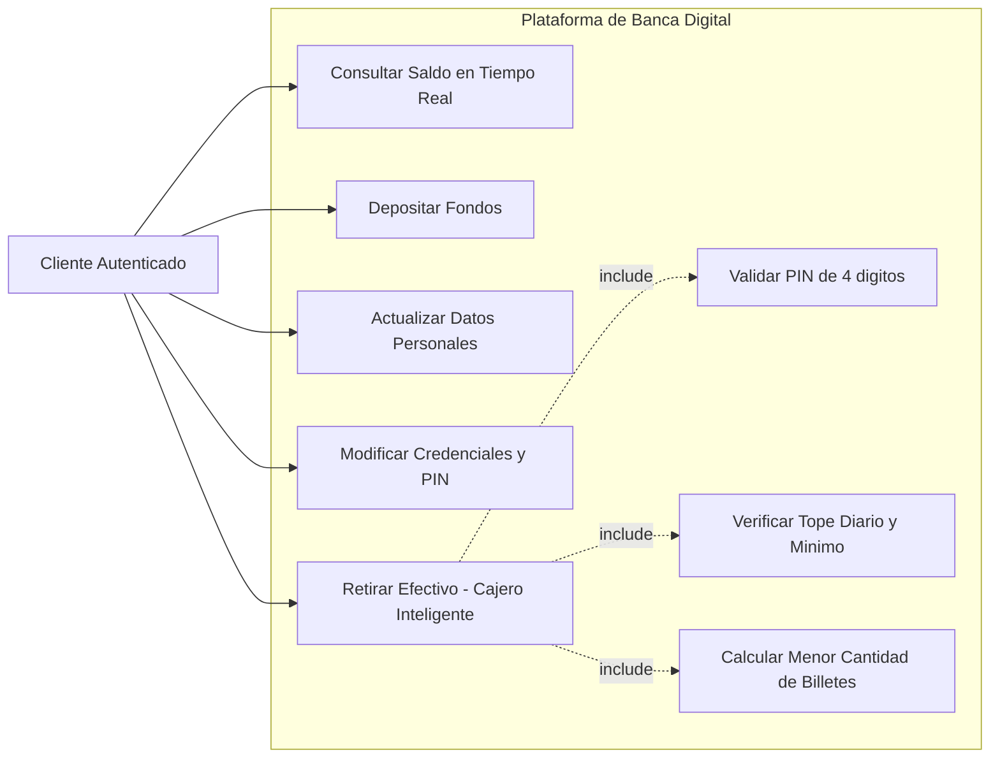
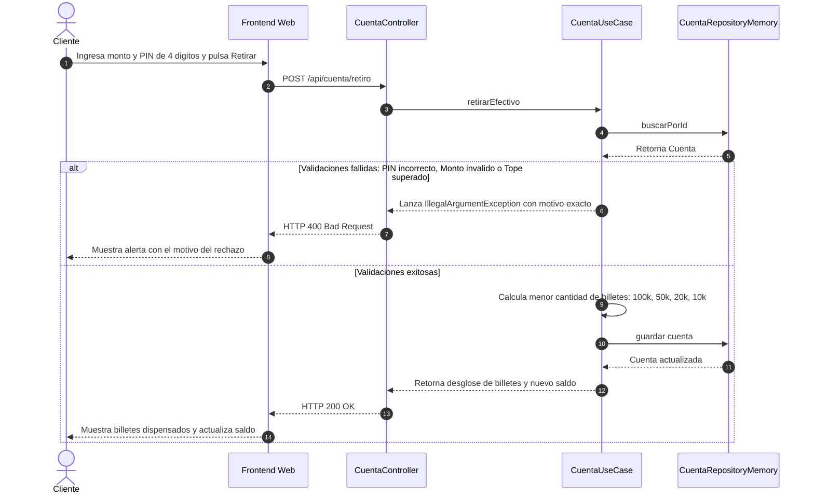
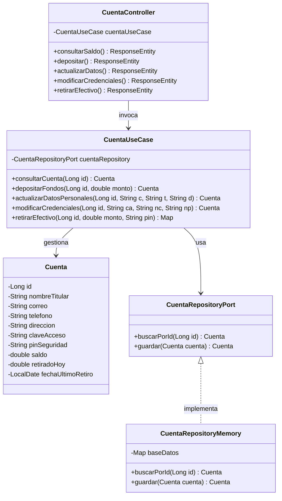
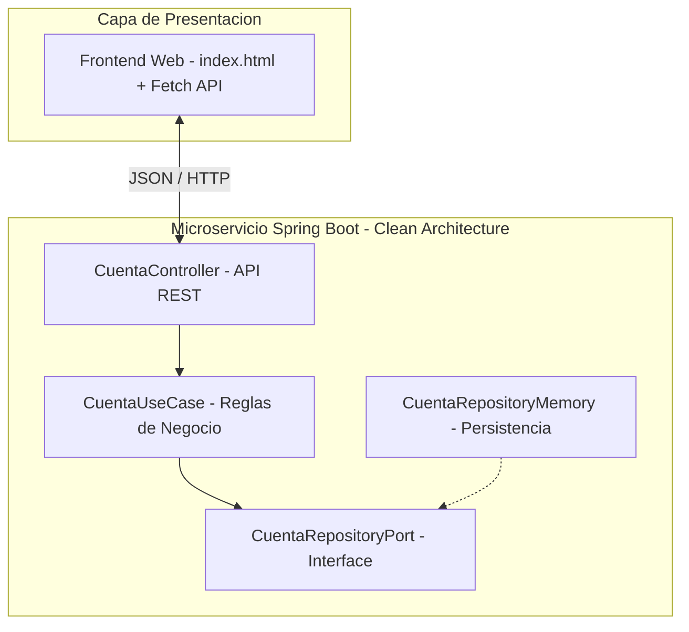

# Parcial Final - Banca Digital UPB
# Parcial Final - Análisis y Diseño de Sistemas (UPB)

Plataforma de Banca Digital con Cajero Automático Inteligente desarrollada en **Spring Boot** (Arquitectura Limpia) y **Frontend Web**.

---

## 1. Ciclo de Vida del Software (SDLC)
Se implementó la metodología ágil **Scrum** articulada con el flujo de ramas **Gitflow** (`feature` -> `develop` -> `main`):
1. **Análisis y Planificación:** Identificación de reglas de negocio del cajero (PIN de 4 dígitos, tope diario de $1.000.000 COP, mínimo de $10.000 COP y dispensación óptima de billetes).
2. **Diseño:** Estructuración en Arquitectura Limpia (Dominio, Aplicación e Infraestructura) y modelado UML.
3. **Desarrollo:** Codificación del microservicio REST en Spring Boot y panel interactivo en HTML/JS en la rama `feature`.
4. **Pruebas:** Verificación de endpoints por URL e interfaz web en la rama `develop`.
5. **Despliegue:** Fusión final hacia la rama `main`.

---

## 2. Elicitación y Especificación de Requerimientos

### Requerimientos Funcionales (RF)
* **RF-01 (Consulta de Saldo):** Visualizar en tiempo real el balance disponible en la cuenta.
* **RF-02 (Depósito de Fondos):** Ingresar dinero mayor a $0 COP para incrementar el saldo.
* **RF-03 (Actualización de Datos Personales):** Modificar correo electrónico, teléfono y dirección del titular.
* **RF-04 (Modificación de Credenciales):** Cambiar la clave de acceso y el PIN transaccional de 4 dígitos.
* **RF-05 (Retiro de Efectivo y Dispensación):** Procesar retiros validando PIN de 4 dígitos, monto mínimo de $10.000 COP, tope máximo diario de $1.000.000 COP y saldo disponible, entregando la menor cantidad de billetes posibles en denominaciones de $100.000, $50.000, $20.000 y $10.000 COP.

### Requerimientos No Funcionales (RNF)
* **RNF-01 (Arquitectura Limpia):** Separación estricta de capas (Dominio, Aplicación, Infraestructura).
* **RNF-02 (API REST):** Comunicación mediante formato JSON y soporte de pruebas por URL.
* **RNF-03 (Manejo de Errores):** Rechazo controlado explicando al usuario el motivo exacto de la denegación.

---

## 3. Historias de Usuario y Criterios de Aceptación

| ID | Historia de Usuario | Puntos | Criterios de Aceptación |
| :--- | :--- | :---: | :--- |
| **HU-01** | **Como** cliente, **Quiero** consultar mi saldo en tiempo real, **Para** conocer mi dinero disponible. | **2** | **Dado** que el usuario abre el panel, **Cuando** se consulta `/api/cuenta/saldo`, **Entonces** muestra el saldo actual y el tope diario restante. |
| **HU-02** | **Como** cliente, **Quiero** depositar dinero, **Para** incrementar mi saldo disponible. | **3** | **Dado** un monto mayor a $0 COP, **Cuando** confirma el depósito, **Entonces** se suma al saldo actual. Si es <= 0, se rechaza. |
| **HU-03** | **Como** cliente, **Quiero** actualizar mi correo, teléfono y dirección, **Para** mantener mis datos al día. | **3** | **Dado** que ingresa nuevos datos válidos, **Cuando** guarda los cambios, **Entonces** se actualiza la información del titular. |
| **HU-04** | **Como** cliente, **Quiero** cambiar mi clave y PIN de 4 dígitos, **Para** mantener la seguridad de mi cuenta. | **5** | **Dado** que ingresa su clave actual correcta y un nuevo PIN de 4 dígitos numéricos, **Cuando** confirma, **Entonces** se actualizan las credenciales. |
| **HU-05** | **Como** cliente, **Quiero** retirar efectivo con mi PIN, **Para** recibir mi dinero en la menor cantidad de billetes posibles. | **8** | **Dado** el PIN correcto de 4 dígitos y un monto múltiplo de $10.000 (mínimo $10.000 y sin superar $1.000.000 en el día), **Cuando** solicita el retiro, **Entonces** descuenta el saldo y entrega billetes de $100k, $50k, $20k y $10k óptimamente. |

---

## 4. Diagramas UML

### 4.1. Diagrama de Casos de Uso

### 4.2. Diagrama de Secuencia (Retiro de Efectivo)

### 4.3. Diagrama de Clases

### 4.4. Diagrama de Componentes

